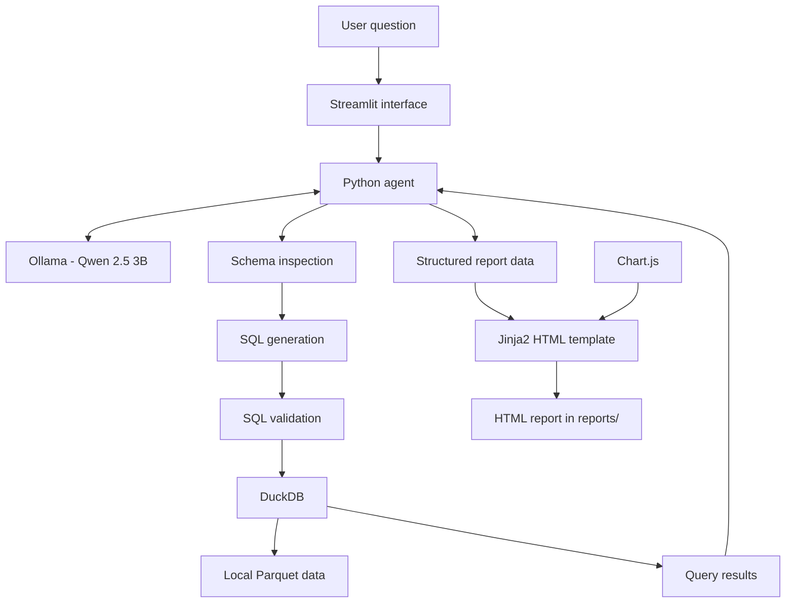

# AI Data Analyst

A local AI-powered data analysis application that lets users ask questions about a dataset in natural language. The application uses a locally running language model to help interpret questions, inspect the available schema, generate SQL, analyze query results, and produce an HTML report with visualizations and written insights.


https://github.com/user-attachments/assets/d0f83507-fb29-4ed4-9dae-be23ec070931


## Project Overview

The goal of this project is to connect natural-language interaction with a reproducible analytical workflow:

1. The user submits a question through the Streamlit interface.
2. The Python agent interprets the request and inspects the available data schema.
3. The agent generates SQL and sends it to the query tool.
4. The query tool validates the SQL and executes it with DuckDB against the local analytical data.
5. The agent uses the returned results to prepare a structured report.
6. Jinja2 renders the report as HTML, while Chart.js provides interactive charts.

The language model runs locally through Ollama. The current configured model is `qwen2.5:3b`.

## Features

- Natural-language questions about a local dataset.
- Local LLM integration through Ollama.
- Schema inspection to help ground SQL generation in the available columns.
- SQL validation before execution.
- DuckDB queries over local Parquet data.
- HTML reports containing KPIs, charts, tables, insights, SQL explanations, and limitations.
- Automated tests for report generation, schema retrieval, and SQL validation.

## Architecture



### SQL validation

The query tool is designed for read-only analytical queries. The automated tests verify that it:

- accepts valid `SELECT` queries;
- adds a result limit when required;
- rejects data-modification statements such as `DROP`, `DELETE`, and `INSERT`;
- rejects multiple SQL statements in a single request; and
- rejects references to unknown tables.

These checks are application-level safeguards. They should not be treated as a substitute for database permissions, operating-system security, or a production security review.

## Technology Stack

| Technology | Purpose |
|---|---|
| Python | Application logic and agent orchestration |
| Streamlit | User interface |
| Ollama | Local LLM runtime |
| Qwen 2.5 3B | Language model used by the agent |
| DuckDB | Analytical SQL execution |
| Parquet | Local analytical data format |
| SQLGlot | SQL parsing, validation support, and formatting |
| Jinja2 | HTML report rendering |
| Chart.js | Charts in generated HTML reports |
| pytest | Automated tests |

## Repository Structure

```text
AI-Data-Analyst/
├── app.py
├── requirements.txt
├── .gitignore
├── metadata/
│   └── schema.json
├── src/
│   ├── __init__.py
│   ├── agent.py
│   ├── criarbanco.py
│   ├── schema_manager.py
│   ├── script.py
│   ├── test_ollama.py
│   └── tools/
│       ├── generate_report.py
│       ├── get_schema.py
│       └── run_query.py
├── templates/
│   └── report.html
├── static/
│   ├── chart.umd.min.js
│   └── CHARTJS-LICENSE.txt
├── tests/
│   ├── test_generate_report.py
│   ├── test_get_schema.py
│   └── test_run_query.py
├── data/
│   ├── raw/
│   │   └── .gitkeep
│   └── curated/
│       └── .gitkeep
└── reports/
    └── .gitkeep
```

Local datasets, generated reports, virtual environments, caches, logs, and local database files are intentionally excluded from version control by `.gitignore`.

## Requirements

- Python installed on your system.
- Git.
- [Ollama](https://ollama.com/) installed and running locally.
- The `qwen2.5:3b` model available in Ollama.
- A compatible source dataset prepared in the location expected by the project.

## Installation

### 1. Clone the repository

Replace the placeholder with the URL of your GitHub repository:

```powershell
git clone https://github.com/Enzo-Teixeira-M/ai-data-analyst.git
cd ai-data-analyst
```
"
### 2. Create and activate a virtual environment

On Windows PowerShell:

```powershell
py -m venv .venv
.\.venv\Scripts\Activate.ps1
```

### 3. Install Python dependencies

```powershell
python -m pip install --upgrade pip
python -m pip install -r requirements.txt
```

### 4. Download the Ollama model

Make sure Ollama is installed and running, then execute:

```powershell
ollama pull qwen2.5:3b
ollama list
```

The model name in the list should match the model configured by the application.

## Data Setup

The dataset and generated analytical files are not included in this repository. This keeps large data files out of Git and avoids redistributing data without confirming its source and license.

The current application expects the curated Parquet file at:

```text
data/curated/vendas.parquet
```

Place the source data in `data/raw/` and use the project's data-preparation logic in `src/criarbanco.py` to produce the curated dataset. Check that script's configured input and output paths before running it. Also verify that `metadata/schema.json` accurately describes the columns in the resulting Parquet file.

The current example data represents an Amazon product catalog. Product prices are in CAD. A field such as `boughtInLastMonth`, when present, is a recent-month indicator rather than a historical time series; it should not be interpreted as evidence of month-by-month trends.

## Run the Application

Activate the virtual environment, ensure Ollama is running and the local dataset is prepared, then start Streamlit:

```powershell
python -m streamlit run app.py
```

Streamlit will print a local address in the terminal. Open that address in your browser to use the application.

## Run the Tests

Run the complete test suite from the repository root:

```powershell
python -m pytest -v
```

Compile the Python source files:

```powershell
python -m compileall app.py src tests
```

The current automated test suite covers report generation, schema retrieval, and SQL query validation. Passing these tests does not replace an end-to-end test with the local Ollama model and the actual dataset.

## Generated Reports

Successful report generation writes an HTML file to the local `reports/` directory. The generated reports are excluded from Git by `.gitignore`; they are created locally when the application runs.

## Current Scope and Limitations

- The application analyzes the data made available to it; the quality of its answers depends on the dataset and its schema.
- The LLM can generate an incorrect interpretation or SQL query. Query validation and result-grounded responses reduce risk but do not guarantee that every analysis is correct.
- Historical trend analysis requires historical data snapshots. A single recent-month indicator is not a time series.
- The project is intended as a local analytics and portfolio project. Review performance, access controls, data governance, and security before adapting it for production use.

## Licensing and Data Attribution

A license for this project's own source code has not yet been selected. Until a license is added, do not assume that the code is available for unrestricted reuse.

Before publishing the repository, verify the source, terms, and redistribution rights for the dataset. Chart.js is distributed under the MIT License; include its license notice when redistributing the bundled Chart.js file. The license for the bundled Chart.js 4.4.7 release is available [here](https://github.com/chartjs/Chart.js/blob/v4.4.7/LICENSE.md).
